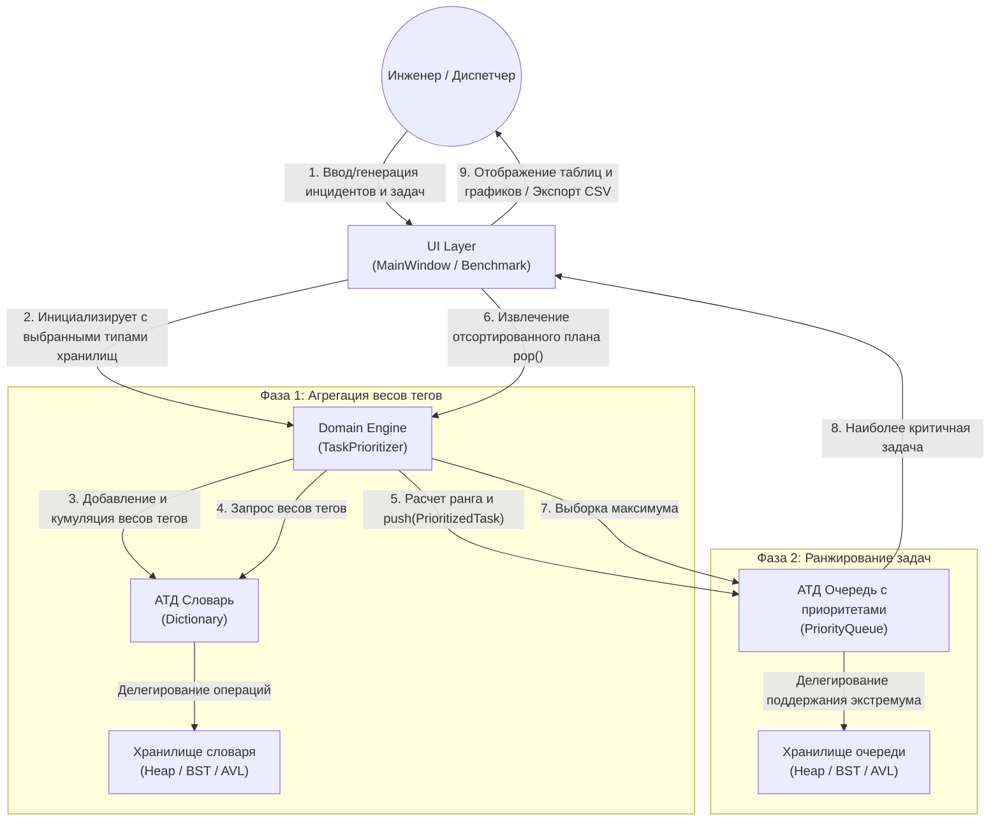

# Техническое задание: Приоритизация задач на основе частотных характеристик инцидентов

---

## 1. Постановка задачи

### 1.1. Идея и математическая модель

В процессе сопровождения и развития сложных программно-аппаратных комплексов непрерывно регистрируется поток инцидентов (сбоев, дефектов, деградаций производительности), в то время как ресурсы команды инженеров по устранению проблем строго ограничены. Возникает критическая задача: **автоматически упорядочить пул задач бэклога по степени их влияния на стабильность системы**, опираясь на накопленную статистику произошедших инцидентов.

Концепция решения базируется на **частотно-взвешенной модели приоритизации через разделяемые семантические маркеры (теги)**. Инциденты и задачи связываются между собой не жесткими прямыми ссылками, а через общее пространство предметных тегов (компоненты системы, сервисы, характер дефекта, стек технологий).

#### Формальная математическая модель:

1. **Множество инцидентов:**
   $$I = \{i_1, i_2, \dots, i_m\}$$
   Каждый инцидент $i_k$ формализуется кортежем:
   $$i_k = (\text{name}_k, p_k, T_k)$$
   где:
   * $\text{name}_k$ — дескриптор инцидента;
   * $p_k \in \mathbb{Z}_{\ge 0}$ — вес (критичность/приоритет) инцидента;
   * $T_k = \{t_{k,1}, t_{k,2}, \dots, t_{k,|T_k|}\}$ — множество уникальных тегов инцидента ($t \in \Sigma^*$).

2. **Множество задач (бэклог):**
   $$S = \{s_1, s_2, \dots, s_n\}$$
   Каждая задача $s_j$ формализуется кортежем:
   $$s_j = (\text{name}_j, T_j, j)$$
   где:
   * $\text{name}_j$ — формулировка задачи;
   * $T_j = \{t_{j,1}, t_{j,2}, \dots, t_{j,|T_j|}\}$ — множество уникальных тегов задачи;
   * $j \in \{0, \dots, n-1\}$ — порядковый индекс задачи при регистрации в пуле (служит детерминированным тай-брейкером для обеспечения стабильности порядка).

3. **Расчет частотно-критической значимости тега:**
   Приоритет $\sigma(t)$ произвольного тега $t$ определяется как суммарный вес всех инцидентов, в которых данный тег был зафиксирован:
   $$\sigma(t) = \sum_{k: t \in T_k} p_k$$
   Если тег $t$ не упомянут ни в одном инциденте, то $\sigma(t) = 0$.

4. **Интегральный приоритет задачи:**
   Приоритет $P(s_j)$ задачи $s_j$ вычисляется как аддитивная свертка значимостей всех её уникальных тегов:
   $$P(s_j) = \sum_{t \in T_j} \sigma(t) = \sum_{t \in T_j} \left( \sum_{k: t \in T_k} p_k \right)$$

5. **Отношение строгого слабого порядка (Strict Weak Ordering):**
   Для формирования очереди задач задается отношение приоритета $\succ$:
   $$s_a \succ s_b \iff (P(s_a) > P(s_b)) \lor \big(P(s_a) = P(s_b) \land a < b\big)$$
   Данное отношение гарантирует:
   * Первоочередное извлечение задач с максимальным суммарным приоритетом;
   * **Стабильность (FIFO-принцип при равенстве весов):** при совпадении рассчитанных приоритетов $P(s_a) = P(s_b)$ преимущество получает задача, внесенная в систему раньше ($a < b$).

---

### 1.2. Область применения и класс решаемых задач

Система решает класс прикладных задач **динамического многокритериального планирования и диспетчеризации ресурсов на основе апостериорного анализа событий**:

* **IT Service Management (ITSM / ITIL):** автоматическое ранжирование очередей тикетов технической поддержки, дефектов в баг-трекерах (Jira, Bugzilla) и задач технического долга по фактическому объему и тяжести инцидентов в production.
* **Security Operations Centers (SOC / SIEM):** приоритизация задач по устранению уязвимостей (Vulnerability Management) на основе корреляции векторов атак с зарегистрированными инцидентами информационной безопасности.
* **Промышленный мониторинг и Predictive Maintenance:** упорядочивание планово-предупредительных ремонтов технологического оборудования на основании телеметрии отказов, предупреждений и аварийных остановок.
* **Логистическая диспетчеризация:** распределение сервисных бригад по заявкам на ремонт инфраструктуры в зависимости от плотности и критичности сбоев в узлах сети.

---

## 2. Сущности прикладной задачи

### 2.1. Описание сущностей предметной области

В предметной области решаемой задачи выделяются следующие концептуальные сущности:

* **Инцидент (Incident):** факт сбоя или нештатной ситуации, произошедшей в системе. Характеризуется строковым описанием, числовой оценкой критичности и набором классифицирующих признаков (тегов).
* **Критичность инцидента (Incident Priority / Severity):** неотрицательная величина ($p \ge 0$), отражающая ущерб или опасность инцидента.
* **Тег / Семантический маркер (Tag / Keyword):** атомарная предметная метка (наименование модуля, подсистемы, типа ошибки или протокола), определяющая контекст инцидента или область действия задачи.
* **Вес тега (Tag Weight):** вычисленный совокупный показатель значимости конкретного маркера, аккумулирующий критичность всех связанных с ним инцидентов.
* **Задача (Task / Work Item):** планируемое инженерное действие по устранению причин проблем или доработке системы, размеченное соответствующими тегами.
* **Ранг задачи (Task Priority):** интегральный расчетный показатель важности задачи, вычисленный на основе весов входящих в неё тегов.
* **Порядок поступления (Task Order / Arrival Index):** хронологический индекс постановки задачи, обеспечивающий справедливое разрешение коллизий (FIFO).
* **Очередь исполнения (Execution Queue / Dispatch Plan):** ранжированный перечень задач, предоставляющий клиенту следующую наиболее критичную задачу к исполнению.

---

### 2.2. Связи между сущностями

* **Инцидент** классифицируется множеством **Тегов** ($1 \dots N$) и наделен скалярной **Критичностью**.
* **Тег** агрегирует критичность всех инцидентов, в которых он упомянут, формируя суммарный **Вес тега**.
* **Задача** ассоциирована с набором **Тегов** ($0 \dots K$) и обладает хронологическим **Порядком поступления**.
* **Ранг задачи** формируется путем суммирования **Весов** всех уникальных **Тегов**, привязанных к данной задаче.
* **Очередь исполнения** упорядочивает **Задачи** на основе их **Ранга** и **Порядка поступления**.

---

## 3. Архитектура

### 3.1. Компонентная структура системы

Система проектируется в виде многоуровневой модульной архитектуры с четким разделением ответственности (Separation of Concerns):

1. **User Interface Layer (Слой представления):**
   * `GUI Module (MainWindow)`: графическое приложение на базе Qt6, предоставляющее интерактивный ввод данных, визуализацию инцидентов, задач, промежуточных весов тегов и результирующего плана работ.
   * `Benchmark UI Module & Worker`: подсистема проведения сравнительных испытаний производительности в отдельном потоке execution-пула (`QThread`), предотвращающая блокировку GUI при больших объемах данных.
2. **Application / Domain Logic Layer (Слой прикладной логики):**
   * `TaskPrioritizer`: центральный контроллер прикладной задачи, инкапсулирующий двухфазный алгоритм приоритизации, валидацию данных и замеры времени выполнения этапов.
   * `Data Transfer Objects (DTO)`: структуры `Incident`, `Task`, `PrioritizedTask`.
3. **Abstract Data Types Core (Слой абстрактных типов данных):**
   * `Dictionary<Key, Value>`: АТД ассоциативного массива с контрактом `IDictionaryStorage`, применяемый для хранения отображения «Тег $\to$ Суммарный вес».
   * `PriorityQueue<T>`: АТД очереди с приоритетами с контрактом `IPriorityQueueStorage`, применяемый для динамического извлечения задач по экстремуму.
4. **Pluggable Storage Engines Layer (Слой сменных движков хранения):**
   * `BinaryHeapStorage`: реализация на базе непрерывной двоичной кучи.
   * `BinaryTreeStorage (BST)`: реализация на базе несбалансированного бинарного дерева поиска.
   * `BinaryTreeStorage (AVL / BalancedTree)`: реализация на базе сбалансированного AVL-дерева с логарифмической гарантией высоты.
5. **Foundational Container Layer (Инфраструктурные контейнеры):**
   * `array_sequence` / `mutable_array_sequence`: низкоуровневые динамические массивы из базовой библиотеки структур.

---

### 3.2. Взаимодействие компонентов

#### Пошаговые сценарии взаимодействия:

1. **Сценарий конфигурации и загрузки данных:**
   * Пользователь через GUI задает параметры генерации или вручную заполняет таблицы инцидентов и задач.
   * Пользователь выбирает типы внутренних хранилищ:
     * Для словаря: `Heap`, `BinarySearchTree` или `AVL`;
     * Для очереди: `Heap`, `BinarySearchTree` или `AVL`.
   * Создается экземпляр `TaskPrioritizer`, получающий копии входных последовательностей и фабричные инстансы выбранных бэкендов.

2. **Сценарий выполнения приоритизации (`prioritize()`):**
   * **Этап 1 (Подсчет весов тегов `count_tags()`):**
     * Контроллер очищает словарь и очередь.
     * Запускается таймер фазы 1 (`count_time`).
     * Последовательно перебираются все инциденты.
     * Для каждого уникального тега инцидента выполняется обращение к `Dictionary`:
       * Если тег уже зарегистрирован: `priorities.get(tag) += incident.priority`;
       * Если тег встречен впервые: `priorities.add(tag, incident.priority)`.
     * Фиксируется время выполнения этапа подсчета.
   * **Этап 2 (Построение очереди задач `build_queue()`):**
     * Запускается таймер фазы 2 (`queue_time`).
     * Последовательно перебираются все задачи из входного списка.
     * Для каждой задачи вычисляется $P(s) = \sum \text{priorities.get}(t)$ для всех уникальных тегов задачи, найденных в словаре (отсутствующие теги дают вклад 0).
     * Создается объект `PrioritizedTask`, включающий имя задачи, её теги, рассчитанный ранг $P(s)$ и исходный индекс $j$.
     * Объект помещается в очередь: `queue.push(prioritized_task)`.
     * Фиксируется время построения очереди.

3. **Сценарий выборки результатов:**
   * Интерфейс циклически опрашивает контроллер: пока `prioritizer.empty()` ложно, вызывается `prioritizer.pop()`.
   * Каждая извлеченная задача отображается в результирующей таблице в порядке убывания её критичности.

4. **Сценарий асинхронного бенчмаркинга:**
   * Пользователь запускает измерение на сетке размеров данных ($N$ элементов, $K$ тегов).
   * Фоновый рабочий поток `BenchmarkWorker` последовательно тестирует все 9 комбинаций пар хранилищ (3 типа словаря $\times$ 3 типа очереди).
   * Результаты замеров (`count_ms`, `queue_ms`, `extract_ms`, `total_ms`) аккумулируются и выгружаются в отчет формата CSV.

---

### 3.3. Ключевые алгоритмические решения и проектные компромиссы

* **Двухфазная схема «Словарь $\to$ Очередь»:**
  * *Решение:* Разделение задачи на фазу поиска по ключу (построение инвертированного индекса частот тегов) и фазу упорядочивания элементов (очередь с приоритетом).
  * *Выгода:* Изоляция алгоритмических сложностей. Для словаря ключевой операцией является `get` / `contains_key`, а для очереди — `push` / `pop`.
  * *Компромисс:* Необходимость промежуточного хранения таблицы тегов в оперативной памяти.

* **Фильтрация локальных дубликатов тегов:**
  * *Решение:* Алгоритмическая проверка `repeated_tag()` перед учетом тега.
  * *Выгода:* Предотвращение искусственного завышения приоритета, если в одном инциденте или задаче по ошибке несколько раз продублирован один и тот же тег (например, `["auth", "auth", "db"]`).
  * *Компромисс:* Локальное время проверки дубликатов составляет $O(K^2)$ для массива тегов конкретной задачи (при малом числе тегов на задачу $K \le 10$ накладные расходы пренебрежимо малы).

* **Паттерн Bridge для хранилищ:**
  * *Решение:* Использование чистых абстрактных интерфейсов `IDictionaryStorage` и `IPriorityQueueStorage`.
  * *Выгода:* Возможность горячей замены алгоритмов (BST, AVL, Heap) без изменения единой строчки кода в доменном модуле `TaskPrioritizer`.
  * *Компромисс:* Накладные расходы на вызов виртуальных методов и двойную косвенную адресацию.

---

## 4. Функциональные требования и спецификация поведения

### 4.1. Требования к компонентам предметной области

#### К сущности «Инцидент» (`Incident`):
* Хранение строкового дескриптора и целочисленного значения критичности.
* Хранение произвольного списка строковых тегов.
* *Особый сценарий:* Если приоритет инцидента отрицателен ($p < 0$), операция обязана аварийно завершаться выбросом `std::invalid_argument("Приоритет не должен быть отрицательным")`.
* *Особый сценарий:* Пустые строки в качестве тегов недопустимы; при обнаружении генерируется `std::invalid_argument("Тег не должен быть пустым")`.

#### К сущности «Задача» (`Task`):
* Хранение наименования задачи и перечня строковых тегов.
* Инвариант неизменности исходного индекса задачи в процессе обработки.

#### К контроллеру приоритизации (`TaskPrioritizer`):
* **Прием данных:** Инициализация неизменяемыми коллекциями инцидентов и задач с гарантией полного копирования данных (защита от мутаций извне).
* **Конфигурируемость хранилищ:** Поддержка раздельного выбора бэкенда для словаря и бэкенда для очереди (`Heap`, `BinarySearchTree`, `AVL`).
* **Выполнение приоритизации (`prioritize`):**
  * Полный сброс предыдущего состояния очередей и словарей.
  * Идемпотентность: повторный вызов `prioritize()` на тех же данных обязан приводить к идентичному состоянию.
  * Транзакционная безопасность при ошибке: в случае исключения внутреннее состояние очищается.
* **Выборка экстремума:**
  * Метод `top()`: константный просмотр наивысшей задачи без удаления.
  * Метод `pop()`: извлечение наивысшей задачи с удалением из очереди.
  * Метод `empty()`: проверка наличия задач в очереди.
* **Инспекция состояния:**
  * Предоставление константной ссылки на словарь рассчитанных весов тегов (`get_tag_priorities()`).
  * Предоставление раздельного времени расчета весов (`get_count_time()`) и построения очереди (`get_queue_time()`) в миллисекундах с субмиллисекундной точностью.

---

### 4.2. Особые и граничные сценарии

| Сценарий | Входные условия | Ожидаемое поведение системы |
| :--- | :--- | :--- |
| **Пустой пул инцидентов** | Список инцидентов пуст ($m = 0$), список задач не пуст ($n > 0$). | Словарь тегов пуст. Все задачи получают $P(s) = 0$. Задачи упорядочиваются строго по возрастанию исходного индекса (FIFO). |
| **Пустой бэклог задач** | Список инцидентов не пуст ($m > 0$), список задач пуст ($n = 0$). | Словарь тегов успешно наполняется весами. Очередь задач пуста (`empty() == true`). Метод `top()` / `pop()` на пустой очереди генерирует исключение. |
| **Полное отсутствие пересечений** | Множества тегов инцидентов и задач не имеют общих элементов ($\bigcup T_k \cap \bigcup T_j = \emptyset$). | Ни один тег задач не найден в словаре. Все задачи получают ранг 0 и выдаются в порядке их поступления ($0, 1, \dots, n-1$). |
| **Повторяющиеся теги в инциденте** | Инцидент содержит одинаковые теги: `tags = ["network", "network"]`, приоритет $5$. | Тег `network` учитывает вес инцидента ровно один раз ($+5$, а не $+10$). |
| **Повторяющиеся теги в задаче** | Задача содержит одинаковые теги: `tags = ["db", "db"]`, вес тега `db` равен $10$. | Вес тега суммируется в ранг задачи ровно один раз ($P = 10$, а не $20$). |
| **Одинаковые ранги задач** | Задачи $A$ (индекс 2) и $B$ (индекс 5) получили одинаковый ранг $P(A) = P(B) = 15$. | В очереди задача $A$ гарантированно располагается выше задачи $B$ ($A \succ B$), так как $2 < 5$. |
| **Инциденты с нулевым приоритетом** | Критичность инцидента $p = 0$. | Теги регистрируются в словаре со значением 0 и не искажают веса других инцидентов. |
| **Отрицательный вес инцидента** | Критичность инцидента $p < 0$. | Выброс исключения `std::invalid_argument`. Данные не принимаются к расчету. |

---

### 4.3. Требования к пользовательскому интерфейсу (GUI)

* **Редактирование данных:** Табличное представление списков инцидентов и задач с поддержкой добавления, изменения, удаления строк и очистки таблиц.
* **Генератор тестовых данных:** Возможность автоматической случайной генерации $N$ инцидентов и $M$ задач с ограничением мощности алфавита тегов ($K$ тегов) для нагрузочных тестов.
* **Управление алгоритмическим базисом:** Раскрывающиеся списки выбора комбинаций хранилищ для словаря и очереди.
* **Инспекция промежуточных расчетов:** Отдельная таблица рассчитанных весов тегов с возможностью сортировки по убыванию частоты/веса.
* **Инспекция результатов:** Таблица приоритизированных задач с отображением расчетного ранга, исходного индекса и списка тегов.
* **Панель бенчмаркинга:**
  * Запуск серии сравнительных тестов всех 9 конфигураций на одинаковых данных.
  * Индикация прогресса выполнения (`QProgressBar`).
  * Неблокирующий интерфейс за счет выноса расчетов в фоновый поток `QThread`.
  * Экспорт сводной таблицы замеров в открытый формат CSV.

---

## 5. Нефункциональные требования

### 5.1. Анализ алгоритмической сложности и производительности

Пусть:
* $M$ — количество инцидентов;
* $N$ — количество задач;
* $L_{inc}$ — среднее число тегов в инциденте;
* $L_{task}$ — среднее число тегов в задаче;
* $K$ — общее число уникальных тегов во всей системе ($K \le M \cdot L_{inc}$).

#### Сравнительная асимптотическая таблица операций по типам бэкендов:

| Этап приоритизации | Базовые операции | Heap (Куча) | BST (Дерево поиска, среднее/худшее) | AVL (Сбалансированное дерево) |
| :--- | :--- | :---: | :---: | :---: |
| **Фаза 1: Подсчет тегов** | $M \cdot L_{inc}$ поисков и вставок в словарь | $O(M \cdot L_{inc} \cdot K)$ *(катастрофическая деградация из-за $O(K)$ поиска)* | $O(M \cdot L_{inc} \cdot \log K)$ / $O(M \cdot L_{inc} \cdot K)$ | $\mathbf{O(M \cdot L_{inc} \cdot \log K)}$ *(оптимально)* |
| **Фаза 2: Построение очереди** | $N \cdot L_{task}$ поисков в словаре $+$ $N$ вставок в очередь | $O(N \cdot L_{task} \cdot T_{dict} + \mathbf{N \log N})$ | $O(N \cdot L_{task} \cdot T_{dict} + N \log N)$ / $O(N^2)$ | $O(N \cdot L_{task} \cdot T_{dict} + \mathbf{N \log N})$ |
| **Фаза 3: Извлечение всех задач** | $N$ операций `pop()` | $\mathbf{O(N \log N)}$ | $O(N \log N)$ / $O(N^2)$ | $\mathbf{O(N \log N)}$ |

---

### 5.2. Тестируемость и критерии приемки

1. **Модульное тестирование (Google Test):**
   * 100% покрытие ключевых сценариев: приоритизация по умолчанию, взвешенные теги, множественные теги, пустые списки, одинаковые веса, детерминированность порядка.
   * Тестирование генератора параметров и валидации некорректного ввода (отрицательные веса, пустые теги).
2. **Гарантии безопасности памяти:**
   * Полное отсутствие утечек памяти и неопределенного поведения при сборке с флагами AddressSanitizer и UndefinedBehaviorSanitizer:
     `-fsanitize=address,undefined`.
   * Корректная очистка динамических структур при исключениях в процессе расчета.

---

### 5.3. Ограничения архитектуры и альтернативные решения

* **Ограничение текущего решения:**
  * Использование древовидных структур для словаря дает логарифмическую задержку $O(\log K)$ на каждый тег, что уступает среднему константному времени $O(1)$ хеш-таблиц.
  * Хранение задач в непрерывных деревьях поиска сопровождается накладными расходами на выделение памяти под каждый узел (`new Node`).
* **Альтернативные промышленные решения:**
  * **Хеш-таблица  для словаря:** позволила бы ускорить фазу подсчета тегов в 3–5 раз за счет эффективного кэширования процессора.