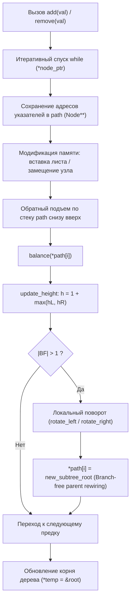

# Техническое задание: Самобалансирующееся AVL-дерево (Balanced Tree)

## 1. Концепция и постановка задачи

### Проблема геометрической асимметрии и деградации
В обычном двоичном дереве поиска форма ветвления целиком определяется порядком поступления данных. При монотонном возрастании ключей ($1, 2, 3, \dots, N$) дерево вырождается в связный список: его высота становится равной $N$, а поиск деградирует из эффективного логарифмического в медленный линейный перебор $O(N)$.

AVL-дерево решает эту фундаментальную проблему геометрической асимметрии. Концепция структуры — **активное динамическое самобалансирование**. Дерево вводит строгий топологический инвариант: для каждого узла разница высот его левого и правого поддеревьев (показатель баланса) по модулю не превышает единицу:
$$|Height(LeftSubtree) - Height(RightSubtree)| \le 1$$

Если добавление или удаление элемента приводит к нарушению инварианта ($BalanceFactor = \pm 2$), дерево выполняет строго локальные топологические перестройки — **вращения (повороты)**. Эти операции за время $O(1)$ восстанавливают баланс высот, не нарушая инвариант поиска.

### Область применения и класс решаемых задач
AVL-дерево применяется там, где критически важна **предсказуемость и гарантия времени отклика**:
* **Высоконагруженные базы данных и транзакционные индексы:** гарантированное время выполнения операций поиска, вставки и удаления за $O(\log N)$ даже в наихудших сценариях распределения ключей.
* **Системы реального времени (Hard Real-Time):** соблюдение жестких временных рамок (SLA) выполнения поисковых запросов.
* **Защита от алгоритмических атак (Anti-DoS):** предотвращение искусственного замедления системы злоумышленником, подающим упорядоченные потоки ключей.
* **Индексы с преобладанием запросов на чтение:** строгая балансировка обеспечивает минимально возможную высоту среди всех разновидностей деревьев поиска.

---

## 2. Предметная модель и сущности

### Анализ понятий предметной области
В концепции самобалансирующегося индекса выделяются следующие предметные сущности:
* **Индексная запись:** информационный элемент с ключом и вычисляемой характеристикой глубины.
* **Метрика глубины (Высота узла):** количество уровней иерархии от данного узла до самого дальнего листа в его поддеревьях.
* **Фактор асимметрии (Показатель баланса):** числовой дифференциал высот потомков, сигнализирующий о перекосе ветвления.
* **Топологический компенсатор (Механизм вращения):** локальное преобразование связей между узлами, уменьшающее высоту перегруженной ветви.
* **Траектория модификации:** цепочка предков от корня до точки изменения, на которой требуется обратный пересчет высот и проверка баланса.

### Связи между сущностями
* **Индексная запись** динамически вычисляет свою **Метрику глубины (высоту)** на основе максимальной высоты своих дочерних поддеревьев.
* Разность метрик глубины левого и правого потомков формирует **Фактор асимметрии (показатель баланса)** для текущей записи.
* При выходе фактора асимметрии за допустимые границы $[-1; +1]$ активируется **Топологический компенсатор (механизм вращения)**.
* **Траектория модификации** последовательно передаёт узлы снизу вверх механизму вращения, который локально перестраивает связи и восстанавливает баланс всего дерева.

---

## 3. Архитектурное решение

### 3.1. Архитектурный каркас: Специализация базового дерева (Наследование от `BinarySearchTreeBase`)
Архитектура `BalancedTree` спроектирована не как обособленный контейнер, а как специализированный производный класс от `BinarySearchTreeBase<T>`, реализующий паттерн **Template Method (Шаблонный метод)** и полиморфную фабрику:

* **Инвариантный базовый слой (наследуется из базы на 100% без дублирования кода):**
  * Алгоритмы итеративного поиска (`get`, `contains`, `find_node`);
  * Функциональные операторы фильтрации и трансформации (`where`, `map`, `reduce`);
  * Подсистемы обходов (`traverse`) и поуровневой визуализации (`TreePrinter`);
  * Сериализация в строковое представление (`to_string`);
  * Проверка структуры и изоморфизма поддеревьев (`get_subtree`, `contains_subtree`);
  * Управление памятью, рекурсивная глубокая очистка (`clear`) и деструктор.
* **Зона ответственности `BalancedTree` (переопределяет ровно 4 виртуальных метода):**
  * `add(const T&)` — вставка с самобалансировкой;
  * `remove(const T&)` — удаление с каскадной самобалансировкой;
  * `create_empty()` — чисто виртуальная фабрика, возвращающая `new BalancedTree<T>(compare)` для сохранения AVL-типа при функциональных операциях;
  * `copy()` — глубокое полиморфное клонирование сбалансированного экземпляра.
* **Внутренний закрытый аппарат балансировки:**
  * Алгоритмические методы: `balance(Node*)`, `rotate_left(Node*)`, `rotate_right(Node*)`, `update_height(Node*)`.
  * Узел `Node` заимствуется из `BinarySearchTreeBase<T>::Node` (поле `height` базово заложено в узел, поэтому структура памяти узлов полностью совместима).

### 3.2. Алгоритмический конвейер модификации и потоки указателей

Модификация дерева организована через итеративный конвейер со стеком косвенных указателей, связывающий спуск, локальное изменение и обратный подъем с балансировкой:

#### Пошаговые сценарии выполнения в кодовой базе:

1. **Сценарий самобалансирующейся вставки (`add`):**
   * Создается динамический массив косвенных указателей `mutable_array_sequence<Node**> path`.
   * Указатель `Node** temp = &root` итеративно спускается по ветвям. На каждом шаге адрес текущего указателя сохраняется: `path.append(temp)`.
   * При обнаружении совпадения ключа выбрасывается `std::runtime_error("Value already exists")`, состояние дерева не нарушается.
   * В найденную позицию записывается новый лист: `*temp = new Node(value)`.
   * Запускается обратный цикл от нижнего предка к корню: 
     `for (int i = path.get_length() - 1; i >= 0; --i) *path[i] = balance(*path[i]);`.
   * Разыменование `*path[i]` напрямую перезаписывает указатель в родительском узле (или в поле `root`), восстанавливая баланс всего дерева.

2. **Сценарий двухуровневого удаления с балансировкой (`remove`):**
   * Выполняется спуск к удаляемому узлу с фиксацией длины основного пути `main_path_length = path.get_length()`.
   * Если у узла менее двух потомков: указатель родителя `*node_ptr` перевешивается на единственного потомка (или `nullptr`).
   * Если у узла два потомка (двухуровневый алгоритм):
     1. Спуск продолжается в правое поддерево к in-order преемнику (крайнему левому узлу) с добавлением адресов в тот же стек `path`.
     2. Первый проход балансировки: подъем от преемника до точки ветвления (`for i from path.length-1 down to main_path_length`).
     3. Преемник замещает удаляемый узел, связываясь с его потомками.
     4. Узел удаляется из памяти через `delete removed`.
     5. Второй проход балансировки: каскадный подъем от точки замещения до самого корня дерева (`for i from main_path_length-1 down to 0`).

### 3.3. Ключевые алгоритмические решения и проектные компромиссы

* **Архитектурный каркас наследования от `BinarySearchTreeBase`:**
  * *Решение:* `BalancedTree` не создает собственную параллельную иерархию, а повторно использует `typename BinarySearchTreeBase<T>::Node` (в котором базово заложено поле `height = 1`) и контракт `INode`.
  * *Выгода:* 100% переиспользование невиртуальных алгоритмов поиска, фильтрации и обходов. Код поиска `find_node` написан один раз в базовом классе и автоматически работает за гарантированные $O(\log N)$ благодаря балансировке наследника.
  * *Компромисс:* Зависимость от защищенных членов базового класса (`using BinarySearchTreeBase<T>::root; size; compare;`).

* **Виртуальная фабрика `create_empty()` и полиморфное сохранение типа:**
  * *Решение:* Реализация метода `virtual BinarySearchTreeBase<T>* create_empty() const override { return new BalancedTree<T>(compare); }`.
  * *Выгода:* Методы `map`, `where`, `get_subtree`, реализованные в базовом классе, при вызове на объекте `BalancedTree` полиморфно инстанцируют и возвращают экземпляр самобалансирующегося дерева с тем же компаратором, гарантируя сохранение свойств AVL во всех дочерних структурах.
  * *Компромисс:* Возврат динамического указателя `BinarySearchTreeBase<T>*` возлагает на вызывающий код ответственность за управление временем жизни результирующего контейнера.

---

## 4. Функциональные требования и спецификация поведения

### Инварианты и правила самобалансировки
* **Инвариант высоты:** после завершения любой модифицирующей операции (`add`, `remove`) для абсолютно каждого узла дерева должно выполняться:
  $$|Height(node.left) - Height(node.right)| \le 1$$

### Контракты модифицирующих операций
* **Вставка с балансировкой (`add`):**
  * Поиск позиции и размещение нового узла с высотой 1.
  * Обратный подъем по пути вставки с обновлением высот.
  * Выполнение поворота при фиксации дисбаланса. 
  * *Особый сценарий:* при попытке добавить существующий ключ выбрасывается `std::runtime_error("Value already exists")`.
* **Удаление с балансировкой (`remove`):**
  * Удаление целевого узла (с замещением in-order преемником при двух потомках).
  * Обратный подъем от точки физического отсоединения узла.
  * *Особый сценарий:* удаление узла может повлечь **каскадную череду поворотов** на каждом уровне вплоть до корня дерева ($O(\log N)$ поворотов).
  * *Особый сценарий:* удаление отсутствующего элемента завершается корректно без модификации структуры.

### Сохранение функциональных свойств
* Вращения являются чисто топологическими операциями и гарантированно сохраняют упорядоченность ключей при симметричном in-order обходе.
* Методы клонирования (`copy`, `create_empty`) возвращают экземпляры `BalancedTree`, гарантируя сохранение балансировки во всех дочерних копиях и поддеревьях.

---

## 5. Нефункциональные требования

### 5.1. Производительность и вычислительная сложность
* **Гарантированная логарифмическая сложность:** время выполнения операций поиска, вставки (`add`) и удаления (`remove`) строго ограничено $O(\log N)$ в худшем случае при любой последовательности входных данных (включая монотонно возрастающие и убывающие потоки).
* **Константная стоимость вращения:** каждое элементарное вращение поддерева (малый или большой поворот) выполняется строго за константное время $O(1)$ с локальным пересчетом высот только затронутых узлов.

### 5.2. Тестируемость и критерии приемки
* **Специализированные тесты самобалансировки:** автоматизированное покрытие всех четырех сценариев вращений (LL, RR, LR, RL) в Google Test.
* **Стресс-тестирование монотонными данными:** проверка глубины дерева и времени работы при вставке миллиона строго упорядоченных элементов (проверка отсутствия деградации).
* **Санитайзеры:** 100% чистота прохождения тестов без утечек памяти и неопределенного поведения под AddressSanitizer.

### 5.3. Ограничения структуры и альтернативные решения
* **Ключевые ограничения AVL-дерева:**
  * *Высокая цена модификаций:* требование жесткого баланса ($|BF| \le 1$) приводит к частым вращениям при вставке и особенно удалении (до $O(\log N)$ вращений при одном `remove`), что делает AVL менее эффективным в сценариях с частой записью данных.
  * *Служебный оверхед памяти:* каждый узел обязан хранить дополнительное поле высоты `height` (или фактор баланса), помимо двух указателей на потомков.
  * *Фрагментация памяти:* как и в любом связном дереве, разрозненные аллокации узлов `new Node` ухудшают использование кэш-линий процессора по сравнению с плоскими массивами.
* **Архитектурные альтернативы:**
  * *Красно-черные деревья (Red-Black Trees / `std::map`):* поддерживают более мягкий баланс, требуя не более 2 поворотов при вставке и не более 3 при удалении. Превосходят AVL по скорости в системах с интенсивным потоком вставок и удалений.
  * *B/B+ деревья:* превосходят бинарные деревья при работе с большими объемами данных во внешней памяти или оперативной памяти за счет блочного размещения.
