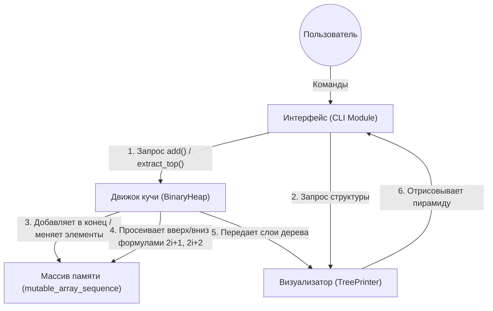

# Техническое задание: Двоичная куча (Binary Heap)

## 1. Концепция и постановка задачи

### Идея и математическая модель
Двоичная куча (Binary Heap) — это **нелинейная структура данных**, организованная в форме полного бинарного дерева (complete binary tree). В куче все уровни иерархии заполнены целиком, за исключением, возможно, последнего, который заполняется строго слева направо без пропусков.

Куча вводит частичный порядок (partial order) на основе **инварианта доминирования предка**:
$$\forall i > 0: Priority(Parent(i)) \succeq Priority(Node(i))$$

Ключевое проектное свойство кучи — **компактное бесуказательное представление в непрерывной памяти**. Благодаря полноте дерева связи между предками и потомками однозначно определяются арифметикой индексов массива:
$$\text{LeftChild}(i) = 2i + 1, \quad \text{RightChild}(i) = 2i + 2, \quad \text{Parent}(i) = \left\lfloor \frac{i - 1}{2} \right\rfloor$$

Такая организация устраняет накладные расходы на хранение трёх указателей на каждый элемент (как в узлах обычных деревьев) и обеспечивает превосходную кэш-локальность процессора.

### Область применения и класс решаемых задач
Двоичная куча решает класс задач оперативного нахождения экстремумов:
* **Мгновенный доступ к наивысшему приоритету:** операция `top` выполняется за $O(1)$ без поиска по коллекции.
* **Пирамидальная сортировка (Heapsort):** гарантированная сортировка произвольного массива за $O(N \log N)$ на месте без привлечения дополнительной динамической памяти.
* **Графовые алгоритмы:** приоритетная очередь для вершин в алгоритмах поиска кратчайших путей (Дейкстра) и минимального остовного дерева (Прим).

---

## 2. Предметная модель и сущности

### Анализ понятий предметной области
В модели приоритетного ранжирования выделяются следующие сущности:
* **Ранжируемый элемент:** прикладной объект, обладающий числовой или сравнимой оценкой приоритета.
* **Шкала доминирования (Компаратор):** правило, определяющее приоритетность одного элемента над другим (min-heap или max-heap).
* **Пул приоритетов:** совокупность элементов, в которой соблюдается условие доминирования родителя над потомками.
* **Глобальный экстремум (Вершина):** корневой элемент пула, обладающий наивысшим приоритетом среди всех находящихся в куче.
* **Просеивание (Sifting):** динамический процесс восстановления локального порядка после добавления или извлечения элемента.

### Связи между сущностями
* **Ранжируемые элементы** поступают в общий **Пул приоритетов**, где их взаимное расположение определяется **Шкалой доминирования (компаратором)**.
* **Шкала доминирования** гарантирует, что в корне пула всегда находится **Глобальный экстремум (вершина)** с наивысшим приоритетом.
* Любое добавление или извлечение элемента инициирует **Процесс просеивания (Sifting)**, который перемещает затронутые элементы вверх или вниз по массиву, динамически восстанавливая целостность и порядок пула приоритетов.

---

## 3. Архитектурное решение

### Компонентная структура системы
1. **Interactive Test Driver (CLI):** консольный интерфейс для заполнения кучи, демонстрации пирамидальной сортировки и бенчмаркинга.
2. **Heap Engine Core (`BinaryHeap`):** алгоритмический компонент, инкапсулирующий логику просеивания (`sift_up`, `sift_down`), извлечения экстремума и линейного построения кучи.
3. **Continuous Memory Storage (`mutable_array_sequence`):** динамический массив, абстрагирующий непрерывный буфер в оперативной памяти.
4. **Hierarchical Level Visualizer (`TreePrinter`):** компонент поуровневой отрисовки срезов кучи в виде графического дерева.

### Взаимодействие компонентов

#### Пошаговые сценарии взаимодействия:

1. **Сценарий добавления элемента (`add`):**
   * Пользователь передает значение через интерфейс.
   * `BinaryHeap` дописывает элемент в конец массива `mutable_array_sequence`.
   * Запускается алгоритм `sift_up`: элемент сравнивается со своим родителем по формуле $(i-1)/2$. Если новый элемент приоритетнее, они меняются местами в массиве. Процесс повторяется до восстановления свойства кучи.

2. **Сценарий извлечения вершины (`extract_top`):**
   * Пользователь запрашивает наиболее приоритетную задачу.
   * `BinaryHeap` читает нулевой элемент массива.
   * Последний элемент массива перемещается на место нулевого, размер массива уменьшается на 1.
   * Запускается алгоритм `sift_down`: элемент сравнивается со своими детьми по формулам $2i+1$ и $2i+2$ и опускается вниз, меняясь местами с лучшим потомком. Исходная вершина возвращается пользователю.

### Ключевые алгоритмические решения и проектные компромиссы

* **Компактное индексное представление без указателей (`mutable_array_sequence`):**
  * *Решение:* Двоичное дерево проецируется на непрерывный динамический массив памяти. Навигация между узлами вычисляется исключительно адресной арифметикой индексов:
    $$\text{Parent}(i) = \lfloor (i - 1) / 2 \rfloor, \quad \text{Left}(i) = 2i + 1, \quad \text{Right}(i) = 2i + 2$$
  * *Выгода:*
    1. *Кэш-локальность (Cache Locality):* элементы размещаются в памяти последовательно, обеспечивая максимальный процент попаданий в кэш-линии процессора (L1/L2). В бенчмарках на $10^6$ вставок куча опережает сбалансированное AVL-дерево более чем в 10 раз (27 мс против 357 мс).
    2. *Нулевой оверхед памяти:* в узлах связного дерева на полезные данные приходится 16-24 байта указателей и высот; в двоичной куче оверхед на связи равен **0 байт**.
  * *Компромисс:* Невозможность произвольного поиска за $O(\log N)$. Куча оптимизирована строго под выборку экстремума; поиск любого другого ключа требует линейного сканирования $O(N)$.

* **Линейное построение кучи по Флойду (Floyd's Heapify):**
  * *Решение:* Конструирование кучи из произвольного входного массива размера $N$ выполняется снизу вверх за $O(N)$ посредством просеивания вниз узлов от $\lfloor N/2 \rfloor - 1$ до $0$.
  * *Выгода:* Сумма высот всех узлов сходится к $\sum_{h=1}^{\log N} \frac{h}{2^h} \cdot N \approx 2N = O(N)$. Это кардинально быстрее наивной последовательной вставки $N$ элементов через `add` ($O(N \log N)$).
  * *Компромисс:* Требует наличия всего набора данных целиком в памяти перед началом процедуры (неприменимо к бесконечным потокам).

* **Двунаправленное просеивание при удалении произвольного элемента (`remove`):**
  * *Решение:* При удалении элемента по произвольному индексу на его место перемещается последний элемент массива. Затем запускается попытка всплытия `sift_up`, а если элемент остался на месте — запускается погружение `sift_down`.
  * *Выгода:* Корректное восстановление инварианта кучи за $O(\log N)$ в одном алгоритмическом блоке без необходимости априорного знания, стал ли перемещенный элемент больше или меньше своих новых соседей.
  * *Компромисс:* Потенциальное выполнение лишнего сравнения на проверку необходимости смены направления просеивания.

* **Поуровневое извлечение поддерева через геометрическую прогрессию индексов (`get_subtree`):**
  * *Решение:* Для любого узла $i$ все его потомки на каждом последующем уровне вычисляются через границы диапазонов $[first, last]$, где на каждом шаге $first' = 2 \cdot first + 1$, $last' = 2 \cdot last + 2$.
  * *Выгода:* Отсутствие рекурсии и стека вызовов при извлечении произвольных иерархических ветвей из плоского массива.
  * *Компромисс:* Необходимость фильтрации индексов, выходящих за физический размер массива на последнем уровне.

---

## 4. Функциональные требования и спецификация поведения

### Базовые операции кучи
* **Добавление элемента (`add`):**
  * Помещение элемента в конец последовательности с последующим `sift_up`.
  * Временная сложность: $O(\log N)$ в худшем случае, $O(1)$ амортизированное среднее.
* **Просмотр вершины (`top`):**
  * Чтение нулевого элемента массива за константное время $O(1)$.
  * *Особый сценарий:* вызов `top` на пустой куче обязан приводить к генерации исключения `std::runtime_error("Heap is empty")`.
* **Извлечение вершины (`extract_top`):**
  * Сохранение значения корня, перенос последнего элемента массива в корень, уменьшение размера и запуск `sift_down(0)`.
  * *Особый сценарий:* вызов на пустой куче генерирует исключение `std::runtime_error("Heap is empty")`.
* **Удаление произвольного элемента (`remove`):**
  * Поиск индекса удаляемого значения по компаратору.
  * Перенос последнего элемента массива на место удаляемого.
  * Адаптивная стабилизация: если перенесенный элемент приоритетнее своего нового родителя — запускается `sift_up`, иначе — `sift_down`.
  * *Особый сценарий:* если удаляемый элемент отсутствует в куче, операция безопасно завершается без изменений.

### Операции анализа поддеревьев
* **`get_subtree(root_value)`:** нахождение первого вхождения значения и формирование независимой валидной кучи из всех его прямых и косвенных потомков. При отсутствии значения — исключение `std::runtime_error`.
* **`contains_subtree(subtree)`:** проверка, содержится ли заданная куча в исходной с сохранением взаимного расположения элементов.

### Функциональные операторы
* **`map(transform)`:** построение новой кучи путем поэлементного преобразования данных с сохранением инварианта доминирования.
* **`where(predicate)`:** фильтрация элементов кучи с формированием нового валидного пула приоритетов.

---

## 5. Нефункциональные требования

### 5.1. Производительность и вычислительная сложность
* **Константный доступ к экстремуму:** операция `top()` выполняется строго за константное время $O(1)$.
* **Логарифмическая модификация пула:** операции `add()` и `extract_top()` выполняются за время $O(\log N)$ в худшем случае.
* **Линейное построение пирамиды (Heapify):** конструирование кучи из произвольного массива размера $N$ выполняется за строго линейное время $O(N)$ методом Флойда.
* **Высокая пропускная способность:** за счет кэш-локальности динамического массива время наполнения кучи $10^6$ элементами не должно превышать 50 мс на современных процессорах.

### 5.2. Тестируемость и критерии приемки
* **Модульное тестирование:** проверка просеивания вверх/вниз, удаления промежуточных элементов, работы пирамидальной сортировки и кастомных компараторов в Google Test.
* **Проверка устойчивости:** стресс-тесты на монотонных, случайных и эквивалентных наборах данных под AddressSanitizer.

### 5.3. Ограничения структуры и альтернативные решения
* **Ключевые ограничения двоичной кучи:**
  * *Невозможность быстрого произвольного поиска:* в куче нет упорядоченности между братьями (левым и правым сыном). Поиск произвольного элемента требует полного перебора всего массива за $O(N)$.
  * *Дорогое слияние двух куч:* объединение двух независимых двоичных куч размером $N$ и $M$ требует слияния массивов и вызова heapify за $O(N + M)$ (невозможно объединить быстрее чем за линейное время).
  * *Невозможность эффективного обхода по порядку:* чтобы обойти элементы кучи в порядке убывания/возрастания, необходимо разрушающе извлечь их все за $O(N \log N)$ (HeapSort).
* **Архитектурные альтернативы:**
  * *$d$-арные кучи ($d$-ary Heap, например $4$-арная куча):* уменьшают высоту дерева в $\log_d 2$ раз, оптимизируя операции `sift_up` под работу с кэшем процессора.
  * *Самобалансирующиеся деревья (AVL / Red-Black):* применяются, когда наряду с извлечением экстремума необходим быстрый поиск произвольного ключа или диапазонные выборки за $O(\log N)$.
