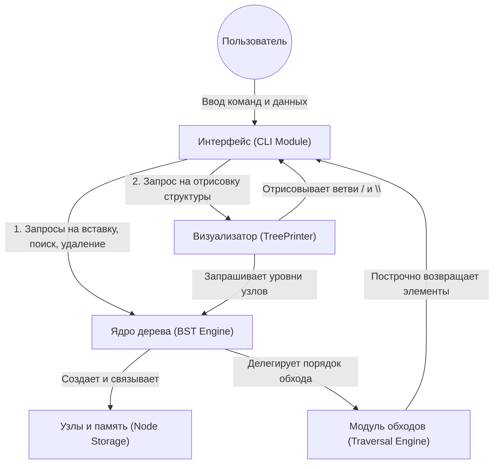

# Техническое задание: Бинарное дерево поиска (Binary Search Tree)

## 1. Концепция и постановка задачи

### Идея и математическая модель
Бинарное дерево поиска (BST) представляет собой **нелинейную иерархическую структуру данных**, организующую элементы в виде ациклического связного графа с выделенным корнем. 

Принципиально важно, что само по себе дерево **не является упорядоченным списком**. Дерево задаёт лишь **пространственное отношение ветвления**: каждый узел делит подмножество своих потомков на два непересекающихся поддерева по локальному инварианту:
$$\forall x \in LeftSubtree(v): Key(x) < Key(v)$$
$$\forall y \in RightSubtree(v): Key(y) > Key(v)$$

Линейный порядок над элементами дерева **не существует статически** — он возникает динамически как результат применения той или иной процедуры **обхода**. Различные способы обхода (LKP, KLP, LPK, обход в ширину BFS) формируют принципиально разные последовательности элементов из одной и той же топологии дерева.

Основная идея структуры — логарифмическое отсечение пространства поиска: на каждом шаге спуска сравнение с текущим узлом позволяет отбросить половину оставшихся вариантов.

### Область применения и класс решаемых задач
Бинарные деревья поиска востребованы в задачах, где требуется динамическое изменение набора данных без дорогостоящей переаллокации непрерывных массивов:
* **Иерархическая динамическая индексация:** ведение справочников и каталогов с частыми вставками и удалениями, где невозможно заранее оценить объем памяти.
* **Диапазонные запросы (Range Queries):** эффективная локализация и выборка подмножеств, ключи которых попадают в интервал $[K_{min}, K_{max}]$.
* **Генерация упорядоченного обхода:** получение отсортированного потока данных без использования внешней сортировки за счет симметричного in-order обхода за $O(N)$.

---

## 2. Предметная модель и сущности

### Сущности прикладной задачи
В рамках решаемой задачи выделяются четыре ключевые сущности:
1. **Информационная запись:** прикладной объект, содержащий ключевой признак (идентификатор) и полезные данные, над которыми выполняются операции хранения, поиска и модификации.
2. **Отношение порядка:** строгое правило сравнения двух записей («меньше», «равно», «больше»), определяющее взаимное расположение элементов и разделяющее данные на две ветви относительно любой опорной точки.
3. **Порядок просмотра:** алгоритмический регламент обхода дерева, определяющий конкретную последовательность извлечения и считывания записей (например, строго по возрастанию ключей, от корня к листьям или по ярусам).
4. **Функциональный оператор:** правило внешней обработки элементов коллекции, выполняющее поэлементную трансформацию (Map), фильтрацию по заданному условию (Where) или кумулятивную свертку (Reduce).

### Связи между сущностями
* **Информационные записи** упорядочиваются и распределяются в структуре на основании **Отношения порядка**, которое позволяет при поиске делить множество записей на меньшие и большие.
* **Порядок просмотра** систематически обходит хранящиеся **Информационные записи**, преобразуя нелинейные ветви структуры в однозначную линейную последовательность для пользователя.
* **Функциональный оператор** применяется к **Информационным записям** в ходе их перебора согласно выбранному **Порядку просмотра**, формируя новые коллекции или результирующие агрегированные значения.

---

## 3. Архитектурное решение

### Компонентная структура системы
Система строится на принципах слабой связанности и разделения ответственности:
1. **Presentation & CLI Layer:** модуль взаимодействия с пользователем, транслирующий команды ввода в вызовы операций над деревом и отображающий результаты.
2. **BST Core Engine (`BinarySearchTreeBase`, `BinarySearchTree`):** алгоритмическое ядро, инкапсулирующее управление узлами, топологию связей и гарантии инварианта поиска.
3. **Traversal Engine (`TreeTraversals`):** изолированная подсистема обходов, предоставляющая 7 независимых проекций дерева (КЛП, КПЛ, ЛКП, ЛПК, ПЛК, ПКЛ, BFS).
4. **Visualization Module (`TreePrinter`):** компонент форматирования двумерного геометрического представления дерева с отрисовкой связующих ребер.

### Взаимодействие компонентов

Взаимодействие компонентов организовано по однонаправленной иерархической схеме: интерфейс управляет деревом, дерево управляет памятью узлов, а сервисные модули привлекаются для форматирования и обходов.

#### Пошаговые сценарии взаимодействия:

1. **Сценарий добавления или удаления элемента:**
   * Пользователь вводит значение в консоль.
   * `CLI Module` проверяет корректность ввода и вызывает метод `add()` или `remove()` у `BST Engine`.
   * `BST Engine` спускается по связям влево/вправо, находит нужную позицию и выделяет новый узел (или аккуратно перевешивает указатели и удаляет старый узел из памяти).
   * Если возникает ошибка (например, попытка добавить дубликат), `BST Engine` генерирует исключение, которое `CLI Module` перехватывает и выводит сообщение об ошибке.

2. **Сценарий поиска записи:**
   * Пользователь запрашивает поиск по ключу.
   * `CLI Module` вызывает метод `contains()` или `get()`.
   * `BST Engine` итеративно спускается по ветвям за логарифмическое время $O(\log N)$, сравнивая ключи, и возвращает найденную ссылку обратно в `CLI Module`.

3. **Сценарий обхода и графической отрисовки:**
   * Пользователь выбирает желаемый способ обхода (например, КЛП, ЛКП или BFS).
   * `CLI Module` передаёт функцию печати в метод `traverse()`.
   * `BST Engine` передаёт корень дерева в `Traversal Engine`, который рекурсивно или через очередь проходит узлы и вызывает печать для каждого элемента.
   * Для наглядного вывода структуры привлекается `TreePrinter`: он запрашивает уровни дерева, выравнивает значения по ширине и соединяет их ветками `/` и `\`.

### Ключевые алгоритмические решения и проектные компромиссы

* **Интерфейс узла `INode` для безопасной навигации (Защищенная инкапсуляция структуры):**
  * *Решение:* Внутри базового класса `BinarySearchTreeBase` объявлен публичный чисто абстрактный интерфейс `INode` с константными методами `get_data()`, `get_left()`, `get_right()`. Физический класс `Node` (содержащий мутабельные указатели `left`, `right`, поле высоты `height`) скрыт в секции `protected`.
  * *Выгода:* Внешние модули (`TreeTraversals`, `TreePrinter`, пользовательские обходчики) получают строго *read-only* доступ к топологии дерева. Они физически лишены возможности повредить связи между узлами, нарушить инвариант дерева поиска или вызвать утечку памяти.
  * *Компромисс:* Накладные расходы на вызов виртуальных методов через vtable при каждом шаге навигации — осознанная плата за абсолютную безопасность инкапсуляции.

* **Внедрение стратегии обхода (Strategy Pattern) вместо жесткой привязки:**
  * *Решение:* Метод `traverse(Visit visit, Traversal traversal = traverse_lkp<T>)` принимает указатель на внешнюю свободную функцию обхода, оперирующую ссылкой на `const INode*`.
  * *Выгода:* Соблюдение Single Responsibility Principle (дерево управляет памятью и балансом, обходчик управляет порядком просмотра) и Open-Closed Principle — пользователь может реализовать собственный алгоритм обхода (например, зигзагообразный, обход Морриса или BFS) и передать его в `traverse()`, не меняя код классов дерева.
  * *Компромисс:* Пользователю необходимо прописывать свою функцию обхода.

* **Виртуальная фабрика (`create_empty` / `copy`) при функциональных операциях (`map`, `where`):**
  * *Решение:* Общие методы фильтрации и трансформации данных (map, where, reduce) не измененяют исходное дерево, создавая результирующий контейнер через чисто виртуальный фабричный метод `create_empty()`.
  * *Выгода:* Устранение дублирования кода: логика фильтрации и трансформации написана один раз в базовом классе, но при вызове `avl.map(f)` автоматически возвращает экземпляр `BalancedTree`, сохраняя свойства самобалансировки, а не наивный `BST`.
  * *Компромисс:* Необходимость возвращать динамический полиморфный указатель `BinarySearchTreeBase*`, возлагая на клиента ответственность за управление временем жизни результирующего дерева.

* **Шаблонный метод (Template Method) в базовом классе:**
  * *Решение:* Все общие операции (поиск, рекурсивная глубокая очистка `clear`, рекурсивное клонирование `copy`, проверка изоморфизма поддеревьев `same_nodes`) реализованы в `BinarySearchTreeBase`. Производные классы определяют исключительно правила мутации (`add`, `remove`).
  * *Выгода:* Монолитная защита от ошибок управления памятью: производные классы не могут случайно допустить утечку при копировании или очистке.

* **Удаление с сохранением топологии:**
  * *Решение:* Узел с двумя потомками замещается минимальным элементом правого поддерева (in-order преемником), после чего исходный преемник удаляется из листа или односвязной позиции.
  * *Выгода:* Минимальное количество перестановок ссылок и сохранение структуры BST.

* **Компараторы через указатели на функции (`int (*compare)(const T&, const T&)`):**
  * *Решение:* Отношение порядка параметризуется свободной функцией-компаратором (по умолчанию `default_compare<T>`, использующей операторы `<` и `>`).
  * *Выгода:* Возможность хранить типы данных без встроенного `operator<` или динамически менять порядок сортировки (прямой / обратный) для одного и того же типа `T`.

---

## 4. Функциональные требования и спецификация поведения

### Базовые операции и их контракты
* **Добавление элемента (`add`):**
  * Спуск по дереву на основе отношения порядка до обнаружения свободной позиции для листа.
  * *Особый сценарий:* если добавляемый ключ уже присутствует в дереве, операция прерывается с генерацией исключения `std::runtime_error("Value already exists")`. Состояние дерева остаётся неизменным.
* **Поиск элемента (`contains`, `get`):**
  * `contains(key)`: проверка наличия ключа с возвратом булева результата за время $O(h)$.
  * `get(key)`: возврат ссылки на найденный элемент.
  * *Особый сценарий:* вызов `get` для отсутствующего ключа генерирует исключение `std::runtime_error("Value is not in the tree")`.
* **Удаление элемента (`remove`):**
  * Локализация узла и аккуратное перестроение связей для трех случаев (0, 1 или 2 потомка).
  * *Особый сценарий:* попытка удаления отсутствующего ключа не является ошибкой; операция завершается нейтрально, размер структуры не меняется.
* **Экстремальные элементы (`top`, `extract_top`):**
  * Чтение и удаление крайнего левого элемента дерева.
  * *Особый сценарий:* вызов на пустом дереве обязан приводить к генерации исключения `std::runtime_error("Tree is empty")`.

### Операции над структурой дерева
* **Извлечение поддерева (`get_subtree`):**
  * Поиск корня поддерева и его глубокое копирование в новый независимый контейнер того же типа. При отсутствии узла — генерация исключения.
* **Проверка вхождения поддерева (`contains_subtree`):**
  * Проверка структурного и информационного изоморфизма заданного образца некоторому поддереву исходной структуры. Пустое дерево всегда считается входящим.

### Функциональные операторы
* **`map(transform)`:** конструирование нового дерева путем применения функции `transform` к каждому узлу.
* **`where(predicate)`:** конструирование нового дерева, включающего только те узлы, для которых предикат вернул `true`.
* **`reduce(function, initial)`:** последовательное накопление результата свертки при симметричном обходе дерева.

---

## 5. Нефункциональные требования

### 5.1. Производительность и вычислительная сложность
* **Временная сложность базовых операций (поиск, вставка, удаление):**
  * В среднем случае (на случайно распределенных ключах): $O(\log N)$.
  * В худшем случае (при монотонном потоке ключей): деградация до $O(N)$ вследствие вырождения в связный список.
* **Линейные операции (`map`, `where`, `reduce`, `traverse`):** строго линейная асимптотика $O(N)$, где $N$ — количество узлов дерева.
* **Проверка изоморфизма (`contains_subtree`):** сложность $O(N \cdot M)$ в худшем сценарии, где $N$ — число узлов исходного дерева, $M$ — размер искомого поддерева.

### 5.2. Тестируемость и критерии приемки
* **Покрытие тестами:** верификация всех открытых методов и сценариев ошибок через автоматизированные наборы тестов Google Test (`gtest`).
* **Проверка надежности памяти:** 100% отсутствие утечек памяти (Zero Memory Leaks), подтверждаемое AddressSanitizer.

### 5.3. Ограничения структуры и альтернативные решения
* **Ключевые ограничения наивного BST:**
  * *Нестабильность глубины и риск вырождения:* форма дерева критически зависит от порядка поступления данных. При подаче отсортированных последовательностей дерево вырождается в односвязный список с падением скорости всех операций до $O(N)$.
  * *Низкая кэш-локальность:* узлы разбросаны по динамической памяти кучи (Heap), навигация по указателям вызывает частые промахи кэша процессора (Cache Misses).
  * *Накладные расходы памяти:* каждый узел хранит как минимум два указателя (`left`, `right`) и служебные данные, что в разы превышает размер самих хранимых данных для примитивных типов.
* **Архитектурные альтернативы:**
  * *Самобалансирующиеся деревья (AVL, Red-Black Tree):* устраняют риск вырождения, гарантируя строгие $O(\log N)$ за счет контрольных вращений.
  * *B-деревья и B+ деревья:* группируют ключи в широкие блоки, минимизируя высоту дерева и обеспечивая максимальную кэш-локальность (стандарт для баз данных и файловых систем).
  * *Хеш-таблицы (Hash Map):* предоставляют среднюю сложность $O(1)$ для поиска и вставки, если не требуются диапазонные запросы и упорядоченный обход.
  * *Сортированный динамический массив:* обеспечивает компактность и мгновенный бинарный поиск за $O(\log N)$ в непрерывной памяти, но требует $O(N)$ на вставку.
