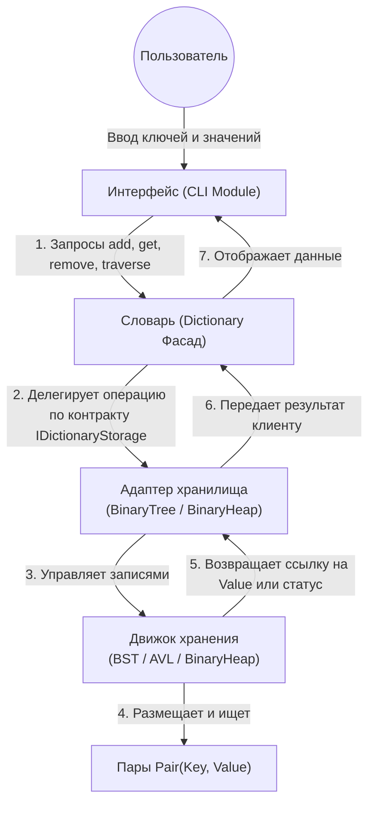

# Техническое задание: Словарь (Dictionary / Map)

## 1. Концепция и постановка задачи

### Идея и математическая модель
Словарь (ассоциативный массив) представляет собой **высокоуровневый абстрактный тип данных (АТД)**, реализующий математическую модель однозначного функционального отображения множества уникальных ключей в множество значений:
$$f: \text{Key} \to \text{Value}$$

Концепция словаря строится на двух фундаментальных проектных принципах:
1. **Ортогональность ключа и значения:** 
   * **Ключ (`Key`)** является поисковым дескриптором и обязан поддерживать отношение строгого порядка для эффективного ветвления в хранилище.
   * **Значение (`Value`)** представляет собой произвольные хранимые прикладные данные (объект сложной модели, текст, указатель на функцию) и **не обязано иметь никаких операторов сравнения**.
2. **Изоляция абстракции от физической реализации (Паттерн Bridge):**
   Пользовательский интерфейс словаря не зависит от того, какая структура данных используется для хранения пар. Словарь выступает фасадом над абстрактным хранилищем `IDictionaryStorage`, позволяя на этапе создания или в рантайме подключать:
   * Двоичное дерево поиска (BST);
   * Самобалансирующееся AVL-дерево;
   * Двоичную кучу (Binary Heap).

### Область применения и класс решаемых задач
Словарь решает класс прикладных задач прямого сопоставления сущностей:
* **Информационно-справочные учетные системы:** поиск сведений о студентах по номеру зачетки, информации о гражданах по паспортным данным, деталей товаров по штрихкоду.
* **Иерархические конфигурационные реестры:** быстрый доступ к параметрам приложения вида `«Key» $\to$ «Value»`.
* **Кэширующие сервисы (In-Memory Key-Value Stores):** удержание часто запрашиваемых результатов вычислений по уникальному ключу запроса.

---

## 2. Предметная модель и сущности

### Анализ понятий предметной области
В модели ассоциативного каталога выделяются следующие предметные сущности:
* **Идентификатор (Ключ / Key):** уникальный поисковый атрибут, служащий адресом информационной записи.
* **Хранимые данные (Значение / Value):** произвольные прикладные данные, ассоциированные с ключом.
* **Ассоциативная пара (Pair):** неделимый кортеж $(Key, Value)$, связывающий идентификатор с соответствующим значением.
* **Каталог (Реестр / Dictionary):** агрегирующий домен, обеспечивающий уникальность ключей и доступ к значениям.
* **Движок хранения (Storage Engine):** внутренняя стратегия структурирования памяти, оптимизирующая операции выборки и обновления.

### Связи между сущностями
* **Каталог (Dictionary)** консолидирует множество **Ассоциативных пар (Pair)**, обеспечивая гарантию уникальности их идентификаторов.
* Каждая **Ассоциативная пара** связывает поисковый **Уникальный ключ (Key)** с прикладными **Хранимыми данными (Значением / Value)**.
* **Каталог** делегирует физическое размещение и навигацию по парам сменному **Движку хранения (Storage Engine)**, изолируя клиентский интерфейс от деталей реализации.

---

## 3. Архитектурное решение

### Компонентная структура системы
1. **Interactive Driver Layer (CLI):** модуль меню, обеспечивающий выбор типов ключей и значений, ручное и пакетное наполнение, запуск профилирования.
2. **Dictionary Abstraction Core (`Dictionary`):** внешний фасад, предоставляющий клиентский API и управляющий временем жизни хранилища.
3. **Storage Abstraction Interface (`IDictionaryStorage`):** чистый интерфейс, определяющий контракт для сменных алгоритмов хранения.
4. **Storage Adapters:**
   * `BinaryTreeDictionaryStorage` — адаптер, транслирующий операции словаря в вызовы BST или AVL-дерева.
   * `BinaryHeapDictionaryStorage` — адаптер над двоичной кучей.
5. **Data Transfer Model (`Pair`):** структура хранения пары «ключ-значение» с компаратором по ключу.

### Взаимодействие компонентов

#### Пошаговые сценарии взаимодействия:

1. **Сценарий добавления пары (`add`):**
   * Пользователь вводит ключ и значение в интерфейсе.
   * `CLI Module` передает пару в метод `Dictionary::add(key, value)`.
   * Фасад `Dictionary` упаковывает данные в объект `Pair<Key, Value>` и вызывает метод `add()` у подключенного адаптера (`BinaryTreeDictionaryStorage` или `BinaryHeapDictionaryStorage`).
   * Адаптер обращается к внутреннему движку (дереву или куче). Движок проверяет уникальность ключа:
     * Если ключ уже существует, генерируется исключение `std::runtime_error("Value already exists")`.
     * Если ключ новый, узел добавляется в структуру данных.
   * `Dictionary` возвращает управление в `CLI Module`, интерфейс сообщает пользователю об успешном добавлении.

2. **Сценарий поиска и модификации значения (`get`):**
   * Пользователь запрашивает получение или редактирование значения по ключу.
   * `CLI Module` вызывает `Dictionary::get(key)`.
   * Адаптер выполняет поиск узла по ключу:
     * В случае дерева: спуск по ветвям за $O(\log N)$.
     * В случае кучи: последовательное сканирование массива за $O(N)$.
   * Если ключ не найден, генерируется исключение `std::runtime_error("Value is not in the tree")`.
   * Если ключ найден, возвращается прямая L-value ссылка `Value&`, позволяющая не только прочитать, но и по месту изменить значение (`dict.get(key) = new_value;`).

3. **Сценарий удаления записи (`remove`):**
   * Пользователь передает ключ для удаления.
   * `Dictionary` делегирует команду в адаптер хранилища.
   * Движок находит пару с данным ключом и аккуратно удаляет её:
     * В дереве: перевешиваются указатели поддеревьев (с балансировкой в AVL).
     * В куче: элемент удаляется с перестановкой последнего элемента и просеиванием.
   * Если ключа не было, операция нейтрально завершается без генерации исключений.

4. **Сценарий сквозного обхода (`traverse`):**
   * `CLI Module` передает визитор (функцию печати или обработки пары) в метод `Dictionary::traverse()`.
   * Адаптер передает визитор во внутренний контейнер, который последовательно проходит по всем сохраненным парам и вызывает обработчик для каждой из них.

### Ключевые алгоритмические решения и проектные компромиссы

* **Обособленная структура `Pair<Key, Value>` с изоляцией порядка от значения:**
  * *Решение:* Создание специализированной структуры `Pair`, в которой операторы сравнения (`<`, `==`, `>`, `<=`, `>=`) перегружены **строго по полю `key`**. Поле `value` полностью исключено из логики упорядочивания.
  * *Выгода:* Возможность хранить в словаре абсолютно любые прикладные типы в качестве хранимых значений (сложные объекты, структуры без операторов равенства, указатели на функции, замыкания). Дерево и куча оперируют объектами `Pair`, используя исключительно отношение порядка ключей.
  * *Компромисс:* Невозможность логарифмического поиска по значению (поиск по значению требует полного линейного сканирования всех элементов).

* **Полиморфное владение хранилищем:**
  * *Решение:* Фасад `Dictionary` инкапсулирует указатель на абстрактный контракт `IDictionaryStorage`, делегируя ему фактическое выполнение операций. Время жизни хранилища контролируется через RAII в деструкторе и семантику перемещения (`move-constructor` / `move-assignment`) с передачей указателя за $O(1)$.
  * *Выгода:* Полная развязка клиентского кода от структур данных. Пользовательский интерфейс и алгоритмы приложения не меняются при переключении между деревьями и кучей.
  * *Компромисс:* Накладные расходы на косвенную адресацию (двойной переход по указателю: `Dictionary` $\to$ `IDictionaryStorage` $\to$ реальная структура данных).

* **Доступ к данным по месту (`Value& get(const Key&)`):**
  * *Решение:* Метод `get` возвращает прямую ссылку на поле `value` найденной внутри структуры пары.
  * *Выгода:* Поддержка естественной inplace-модификации: `dict.get(key) = new_data;` без накладных расходов на удаление старой пары и повторную логарифмическую вставку новой.
  * *Компромисс:* Опасность инвалидации ссылки: если клиент сохраняет полученную ссылку `Value&`, а затем вызывает `remove(key)` или `clear()`, ссылка становится повисшей (dangling reference).

---

## 4. Функциональные требования и спецификация поведения

### Базовые операции словаря
* **Добавление пары (`add`):**
  * Регистрация нового ключа и связывание его с переданным значением.
  * *Особый сценарий:* если ключ уже зарегистрирован в словаре, операция обязана аварийно завершаться генерацией исключения `std::runtime_error("Value already exists")`. Состояние словаря остаётся неизменным.
* **Получение значения (`get`):**
  * Доступ к значению по ключу с возвратом неконстантной ссылки `Value&` (или `const Value&` для константного словаря).
  * *Особый сценарий:* обращение по отсутствующему ключу обязано приводить к генерации исключения `std::runtime_error("Value is not in the tree")`.
* **Удаление записи (`remove`):**
  * Исключение пары из хранилища по заданному ключу.
  * *Особый сценарий:* удаление несуществующего ключа является безопасной нейтральной операцией и не приводит к ошибке.
* **Проверка наличия ключа (`contains_key`):**
  * Возврат `true`, если ключ присутствует в словаре, и `false` в противном случае.
* **Очистка (`clear`):**
  * Полное освобождение всех хранящихся ассоциаций и сброс размера в 0.

### Итерирование и обход
* **Сквозной перебор (`traverse`):**
  * Последовательный вызов визитора `Visit(const Key&, const Value&)` для каждой зарегистрированной пары.
  * Передача нулевого указателя на визитор вызывает генерацию исключения `std::invalid_argument`.

### Управление жизненным циклом
* Словарь единолично владеет переданным ему объектом хранилища (через динамический указатель) и гарантирует его корректное освобождение в деструкторе.
* Поддержка семантики перемещения (`move-constructor`, `move-assignment`) с мгновенной передачей владения ресурсом за $O(1)$.

---

## 5. Нефункциональные требования

### 5.1. Производительность и вычислительная сложность
* **Асимптотическая сложность по типам хранилищ:**
  * *На базе AVL-дерева (`BalancedTree`):* поиск, вставка и удаление гарантированно выполняются за $O(\log N)$ в худшем случае.
  * *На базе наивного BST (`BinarySearchTree`):* $O(\log N)$ в среднем, $O(N)$ в худшем случае при монотонных потоках.
  * *На базе кучи (`BinaryHeap`):* поиск произвольного ключа за $O(N)$, пакетное наполнение за $O(N^2)$ вследствие обязательной проверки инварианта уникальности ключа.
* **Эффективность перемещения:** передача владения словарем через move-семантику выполняется строго за константное время $O(1)$ без копирования элементов.

### 5.2. Тестируемость и критерии приемки
* **Модульное тестирование:** автоматизированная проверка работы словаря на всех трех типах бэкендов (BST, AVL, Heap) в Google Test.
* **Проверка краевых сценариев:** тестирование доступа по отсутствующему ключу, попыток повторной вставки, перемещения и очистки словаря.
* **Безопасность памяти:** 100% отсутствие утечек памяти под AddressSanitizer (`-fsanitize=address,undefined`).

### 5.3. Ограничения структуры и альтернативные решения
* **Ключевые ограничения текущей архитектуры словаря:**
  * *Логарифмическая асимптотика доступа:* поиск по дереву требует $O(\log N)$ переходов по указателям, что уступает константному доступу $O(1)$ хеш-таблиц.
  * *Катастрофическая деградация на куче:* использование двоичной кучи в роли бэкенда приводит к квадратичной сложности $O(N^2)$ при наполнении из-за линейной проверки `contains_key`.
  * *Фрагментация памяти при хранении пар:* размещение каждой пары `Pair` в отдельном узле дерева снижает пространственную локальность данных.
* **Архитектурные альтернативы:**
  * *Хеш-таблицы (Hash Map с открытой адресацией / Flat Map / Swiss Tables):* промышленный стандарт ассоциативных массивов; гарантируют среднее время $O(1)$ на вставку и поиск, размещая данные в плоских массивах.
  * *B+ деревья:* промышленный стандарт для индексации в реляционных базах данных, минимизирующий число обращений к страницам памяти.
