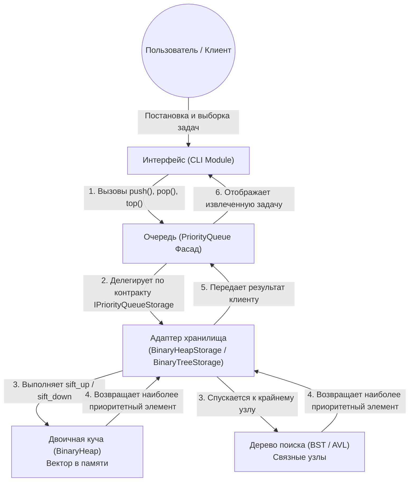

# Техническое задание: Очередь с приоритетами (Priority Queue)

## 1. Концепция и постановка задачи

### Идея и математическая модель
Очередь с приоритетами представляет собой **высокоуровневый абстрактный тип данных (АТД)**, организующий динамический пул задач, для которого нарушается стандартный принцип обслуживания FIFO («первым пришёл — первым обслужен»). 

Концепция структуры — **ранжированное диспетчеризирование**: порядок извлечения элементов строго подчинен их сравнительной важности (приоритету). Независимо от того, когда элемент был помещен в очередь, операция выборки всегда извлекает глобальный экстремум:
$$\text{Extract}() \to x \in Queue : \forall y \in Queue, Priority(x) \succeq Priority(y)$$

Архитектура очереди реализует паттерн *Bridge / Strategy*, изолируя клиента от деталей физической организации приоритетного пула. В качестве взаимозаменяемых стратегий поддерживаются:
1. Двоичная куча (`BinaryHeapStorage`);
2. Бинарное дерево поиска (`BinaryTreeStorage` на базе BST);
3. Самобалансирующееся AVL-дерево (`BinaryTreeStorage` на базе `BalancedTree`).

### Область применения и класс решаемых задач
Очередь с приоритетами необходима для решения прикладных задач планирования и диспетчеризации:
* **Диспетчеризация процессов и потоков в операционных системах:** распределение квантов времени процессора наиболее критичным системным задачам перед фоновыми процессами.
* **Сетевая маршрутизация с контролем качества обслуживания (QoS):** высокоприоритетная передача потокового мультимедиа и сигналов управления перед трафиком пакетной передачи файлов.
* **Имитационное моделирование систем с дискретными событиями:** организация глобального календаря событий, где события извлекаются в строгом хронологическом порядке их модельного времени наступления.
* **Управление инцидентами:** приоритизация аварийных оповещений по шкале критичности последствий.

---

## 2. Предметная модель и сущности

### Анализ понятий предметной области
В модели приоритетной диспетчеризации выделяются предметные сущности:
* **Заявка / Задача (Work Item):** прикладной объект или функция, ожидающая выполнения.
* **Метрика приоритета (Urgency):** сравнимый количественный или ранговый показатель важности заявки.
* **Диспетчер очереди (Priority Dispatcher):** компонент, консолидирующий поступающие заявки и организующий их непрерывное ранжирование.
* **Исполнитель (Consumer):** внешний агент или рабочий поток, запрашивающий у диспетчера очередную наиболее важную задачу.
* **Стратегия отбора (Selection Strategy):** алгоритмический механизм поддержания порядка экстремума в хранилище.

### Связи между сущностями
* Каждая поступающая **Заявка (Work Item)** обладает сравнимой **Метрикой приоритета (Urgency)**, определяющей её место в очереди.
* **Диспетчер очереди** регистрирует входящие заявки и делегирует их ранжирование подключаемой **Стратегии отбора (Selection Strategy)**.
* **Стратегия отбора** гарантирует локализацию и выдачу глобального экстремума обратно диспетчеру.
* **Исполнитель (Consumer)** циклически запрашивает и извлекает из диспетчера наиболее приоритетную задачу, не зная деталей её физического хранения.

---

## 3. Архитектурное решение

### Компонентная структура системы
1. **Interactive Client Layer (CLI):** модуль пользовательского меню, наполнения очереди и профилирования времени работы операций `push` и `pop`.
2. **Priority Queue Abstraction (`PriorityQueue`):** внешний фасад, предоставляющий публичный интерфейс очереди и управляющий временем жизни подчиненного хранилища.
3. **Storage Abstraction Contract (`IPriorityQueueStorage`):** чистый абстрактный интерфейс, формализующий обязательства хранилищ приоритетов.
4. **Concrete Storage Engines:**
   * `BinaryHeapStorage` — адаптер над непрерывной двоичной кучей.
   * `BinaryTreeStorage` — адаптер над деревьями поиска (BST / AVL).

### Взаимодействие компонентов

#### Пошаговые сценарии взаимодействия:

1. **Сценарий постановки задачи в очередь (`push`):**
   * Пользователь или внешний процесс передает задачу с указанием приоритета.
   * `CLI Module` вызывает метод `PriorityQueue::push(item)`.
   * Фасад `PriorityQueue` передает задачу в подключенный адаптер хранилища.
   * Если используется куча (`BinaryHeapStorage`): элемент дописывается в конец массива и просеивается вверх (`sift_up`) за время $O(\log N)$, восстанавливая свойство приоритета.
   * Если используется дерево (`BinaryTreeStorage`): элемент вставляется по правилам BST/AVL за время $O(\log N)$.
   * Размер очереди увеличивается на 1.

2. **Сценарий чтения и извлечения лучшей задачи (`top` и `pop`):**
   * Пользователь запрашивает наиболее приоритетную задачу.
   * `PriorityQueue::top()` проверяет, не пуста ли очередь (если пуста — генерируется исключение `std::runtime_error("Priority queue is empty")`).
   * Адаптер считывает экстремум:
     * В куче: элемент в нулевой позиции массива за $O(1)$.
     * В дереве: крайний левый/правый узел дерева за $O(\log N)$.
   * Метод `pop()` извлекает и удаляет данный элемент:
     * В куче: корень заменяется последним элементом и просеивается вниз (`sift_down`) за $O(\log N)$.
     * В дереве: узел удаляется с перебалансировкой связей за $O(\log N)$.
   * Извлеченное значение возвращается пользователю.

3. **Сценарий недеструктивной фильтрации и трансформации (`map`, `where`, `reduce`):**
   * Пользователь вызывает функциональную обработку пула задач (например, повысить приоритет всех задач или отобрать задачи определенного типа).
   * Метод `PriorityQueue::where(predicate)` создает новую независимую копию очереди.
   * Обработчик обходит все элементы исходной очереди, применяет предикат и сохраняет только подходящие задачи в новую очередь.
   * Исходная очередь остается неизменной, гарантируя безопасность состояния системы при аналитических выборках.

### Ключевые алгоритмические решения и проектные компромиссы

* **Архитектурный мост (Bridge / Strategy Pattern) и аппаратный компромисс бэкендов:**
  * *Решение:* Класс `PriorityQueue` спроектирован как высокоуровневый фасад, который полностью изолирован от деталей физического хранения и управляет полиморфным указателем на абстрактный интерфейс `IPriorityQueueStorage<T>`. Это позволяет прозрачно подменять стратегию организации приоритетного пула: использовать либо непрерывную двоичную кучу на плоском массиве (`BinaryHeapStorage`), либо связное дерево поиска (`BinaryTreeStorage` на базе BST или AVL).
  * *Выгода:*
    1. *Слабая связанность (DIP):* вызывающий код взаимодействует строго с контрактом очереди (`push`, `pop`, `top`), что позволяет менять алгоритмы ранжирования в рантайме без модификации клиентской логики.
    2. *Наглядная демонстрация аппаратного компромисса (Memory Locality vs Pointers):* возможность прямого сравнения структур данных в одинаковых условиях интерфейса. Бенчмарки на $10^6$ элементов показывают, что при одинаковой теоретической сложности $O(\log N)$ куча наполняется за **27 мс**, а AVL-дерево — за **357 мс** (куча быстрее в 13 раз за счет последовательного размещения в кэш-линиях процессора и полного отсутствия вызовов аллокатора `new Node`).
  * *Компромисс:*
    1. *Накладные расходы виртуализации:* каждый вызов метода очереди требует косвенного перехода по указателю и обращения к таблице виртуальных функций (vtable).
    2. *Управление динамическим ресурсом:* необходимость строгого контроля времени жизни объекта хранилища через RAII в деструкторе (`delete storage`) и реализацию перемещения (`std::move`) за $O(1)$ для предотвращения утечек памяти.

---

## 4. Функциональные требования и спецификация поведения

### Базовые операции очереди
* **Постановка задачи в очередь (`push`):**
  * Размещение нового элемента в хранилище с автоматическим сохранением приоритетного порядка.
  * Временная сложность: $O(\log N)$ в худшем случае.
* **Просмотр наивысшей задачи (`top`):**
  * Возврат константной ссылки на экстремальный элемент пула за время $O(1)$.
  * *Особый сценарий:* вызов `top` на пустой очереди обязан приводить к генерации исключения `std::runtime_error("Queue is empty")`.
* **Извлечение наивысшей задачи (`pop`):**
  * Удаление наиболее приоритетного элемента из структуры и возврат его значения.
  * *Особый сценарий:* вызов `pop` на пустой очереди обязан приводить к генерации исключения `std::runtime_error("Queue is empty")`.
* **Запрос состояния (`empty`, `get_size`):**
  * Проверка пустоты и получение точного количества находящихся в очереди задач за время $O(1)$.
* **Очистка (`clear`):**
  * Полное аннулирование всех находящихся в очереди задач.

### Функциональные операторы
* **`map(transform)`:** конструирование новой очереди с модифицированными значениями задач.
* **`where(predicate)`:** фильтрация очереди с сохранением только тех задач, которые удовлетворяют предикату.
* **`reduce(function, initial)`:** последовательное вычисление кумулятивной характеристики (например, суммарного веса задач) в строгом порядке их приоритетного извлечения.

### Управление ресурсами
* Полная поддержка семантики перемещения (`std::move`) с мгновенной передачей владения ресурсом хранилища без копирования элементов.
* Гарантия отсутствия утечек памяти при разрушении объекта очереди (деструктор вызывает `delete storage`).

---

## 5. Нефункциональные требования

### 5.1. Производительность и вычислительная сложность
* **Асимптотическая сложность по типам бэкендов:**
  * *На базе двоичной кучи (`BinaryHeapStorage`):* чтение экстремума `top()` за $O(1)$, постановка `push()` и извлечение `pop()` за $O(\log N)$ в худшем случае (при константном среднем времени вставки).
  * *На базе AVL-дерева (`BinaryTreeStorage`):* гарантированное время $O(\log N)$ на любые модификации и выборку экстремума.
* **Сравнительная пропускная способность:** благодаря кэш-локальности кучевый бэкенд на $10^6$ элементов обязан демонстрировать скорость наполнения не хуже 30-40 мс (в разы быстрее связного дерева).
* **Эффективность перемещения:** передача владения очередью через move-конструктор выполняется за константное время $O(1)$.

### 5.2. Тестируемость и критерии приемки
* **Модульное тестирование:** полное покрытие всех методов очереди для каждого из поддерживаемых хранилищ (куча, BST, AVL) на базе Google Test.
* **Проверка устойчивости:** стресс-тесты с добавлением и извлечением сотен тысяч задач со случайными и монотонными приоритетами под AddressSanitizer.
* **Контроль инвариантов:** строгое сохранение приоритетного порядка при последовательном извлечении элементов из очереди.

### 5.3. Ограничения структуры и альтернативные решения
* **Ключевые ограничения реализованной очереди с приоритетами:**
  * *Отсутствие эффективной смены приоритета (`decrease_key` / `change_priority`):* изменение приоритета задачи «на лету» требует линейного поиска элемента за $O(N)$ с последующим просеиванием.
  * *Нестабильность очереди (Unstable Priority Queue):* элементы с одинаковым приоритетом не гарантируют соблюдения порядка FIFO (первый пришедший с равным приоритетом может быть извлечен позже).
  * *Невозможность быстрого слияния очередей:* объединение двух очередей требует $O(N + M)$ времени.
